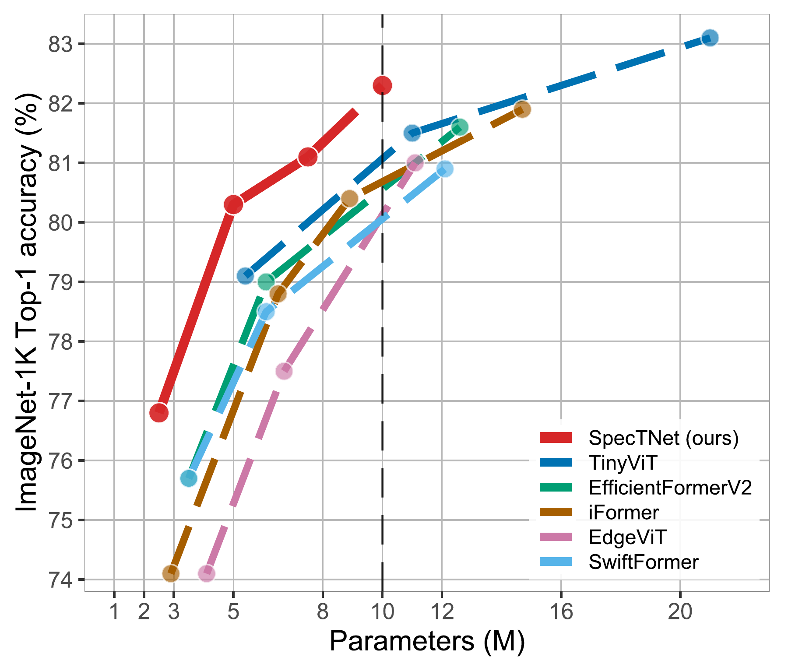
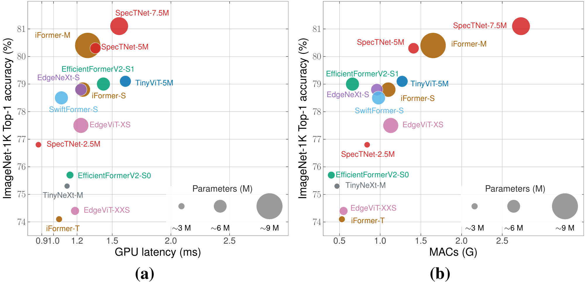

# SpecTNet: Specialized Tetra Network

This repo is the official implementation of Matching Operators to Stages: An Inductive-Bias Specialization Principle for Parameter-Efficient Image Classification.
SpecTNet, Specialized Tetra Network, is a four-stage hybrid architecture for efficient image classification.
Each stage uses an operator family suited to its spatial resolution and feature
representation, progressing from local spatial processing to global mixing.
The architecture combines Multi-Scale Spatial Mixing (MS2M) in the first stage
with feature-preserving downsampling between stages.

## Accuracy and efficiency

  

**Accuracy versus parameters.** SpecTNet variants cover several model sizes,
allowing the accuracy and parameter budget to be compared with other lightweight
architectures.

  

**Accuracy versus inference cost.** The left panel compares GPU latency; the
right panel compares MACs per image. Bubble size represents the parameter
count. These views distinguish model size, arithmetic cost, and measured
execution time.

## ImageNet-1K results and checkpoints

| Model         | Resolution | Top-1 acc. (%) | Params (M) | Latency b1 (ms) | MACs (G) | Checkpoint          |
|:--------------|:----------:|---------------:|-----------:|----------------:|---------:|:--------------------|
| SpecTNet-2.5M | 224 × 224  |           76.8 |        2.6 |           0.871 |     0.85 | [ckpt][checkpoints] |
| SpecTNet-5M   | 224 × 224  |           80.3 |        5.2 |           1.356 |     1.41 | [ckpt][checkpoints] |
| SpecTNet-7.5M | 224 × 224  |           81.1 |        7.4 |           1.558 |     2.73 | [ckpt][checkpoints] |
| SpecTNet-10M  | 224 × 224  |           82.3 |       10.5 |           1.614 |     3.63 | [ckpt][checkpoints] |
| SpecTNet-2.5M | 256 × 256  |           77.4 |        2.6 |           0.904 |     1.12 | [ckpt][checkpoints] |
| SpecTNet-5M   | 256 × 256  |           80.5 |        5.2 |           1.391 |     1.88 | [ckpt][checkpoints] |
| SpecTNet-7.5M | 256 × 256  |           81.7 |        7.4 |           1.624 |     3.62 | [ckpt][checkpoints] |
| SpecTNet-10M  | 256 × 256  |           82.8 |       10.5 |           1.687 |     4.74 | [ckpt][checkpoints] |

[checkpoints]: https://drive.google.com/drive/folders/1bH87E3_VOYRuI5ZedQYxvhn7E_aUccEP?usp=sharing

## Optional stage 1 merging

`INFERENCE.MERGE_STAGE1` defaults to `False` in `config.py`. Set it to `True`
in a YAML configuration or pass `--opts INFERENCE.MERGE_STAGE1 True` when using
`main.py --eval`, `main.py --throughput`, or `inference.py`.